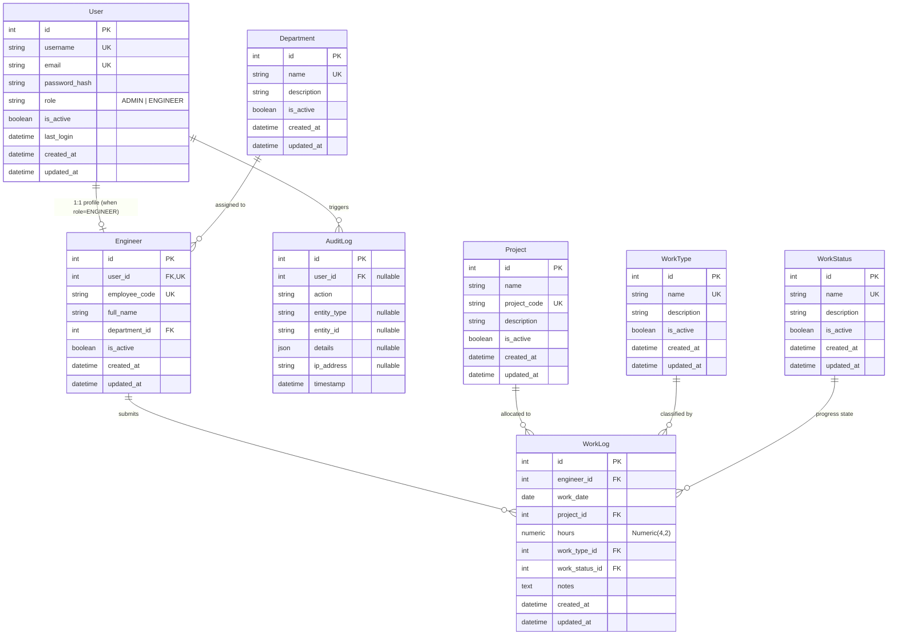

# EngineerHub — Comprehensive System Architecture & Workflow Specification

---

## 1. Executive Summary & Overview

**EngineerHub** is an enterprise-grade internal platform developed for **DME (Technical Office)** to manage engineering workforce operations, project effort tracking, daily work activity logging, departmental distributions, corporate working calendar enforcement, security audit trails, and executive productivity analytics.

The application is engineered with a **modern decoupled desktop architecture**:
- **Backend**: High-performance RESTful API powered by **Python, FastAPI, SQLAlchemy 2.x, Pydantic v2**, and a concurrency-hardened **SQLite** database.
- **Frontend / Desktop Client**: A native **Electron Desktop Application** hosting an optimized **Next.js (React 19)** user interface styled with a bespoke **Linear/Vercel-inspired Dark Mode design system** (using pure CSS Modules).

---

## 2. System Architecture & Data Flow

```text
                    ┌─────────────────────────────────────────┐
                    │               EngineerHub               │
                    │        (Desktop Client Instance)        │
                    │                                         │
                    │   ┌─────────────────────────────────┐   │
                    │   │        Electron Shell           │   │
                    │   │   (Native 1440x900 Window)      │   │
                    │   │                                 │   │
                    │   │   ┌─────────────────────────┐   │   │
                    │   │   │      Next.js React      │   │   │
                    │   │   │  (Dark Mode UI/Charts)  │   │   │
                    │   │   └────────────┬────────────┘   │   │
                    │   └────────────────┼────────────────┘   │
                    └────────────────────┼────────────────────┘
                                         │ (HTTP / JSON REST API)
                                         │ Bearer JWT Authentication
                                         ▼
                    ┌─────────────────────────────────────────┐
                    │          FastAPI REST Backend           │
                    │        (Uvicorn ASGI Server)            │
                    │                                         │
                    │   ├── Router / Endpoints (32 Routes)    │
                    │   ├── RBAC & Security (JWT / Bcrypt)    │
                    │   ├── Business Rules Validation Engine  │
                    │   │   ├── Friday/Saturday Holiday Rule  │
                    │   │   └── Daily Max Hours Protection    │
                    │   ├── Services Layer & Aggregations     │
                    │   └── SQLAlchemy 2.0 ORM Engine         │
                    └────────────────────┬────────────────────┘
                                         │
                                         ▼ (Direct Local / UNC File Access)
                    ┌─────────────────────────────────────────┐
                    │      SQLite Database Engine (WAL)       │
                    │                                         │
                    │   PRAGMA journal_mode = WAL;            │
                    │   PRAGMA busy_timeout = 10000;          │
                    │   PRAGMA foreign_keys = ON;             │
                    │   PRAGMA synchronous = NORMAL;          │
                    └────────────────────┬────────────────────┘
                                         │
                                         ▼
                    ┌─────────────────────────────────────────┐
                    │       Storage Backend (Configurable)    │
                    │   Local File: ./data/engineerhub.db     │
                    │   OR Windows Network Share:             │
                    │   \\DME-SERVER\DME-SHARE\engineerhub.db │
                    └─────────────────────────────────────────┘
```

> **Core Architectural Rule**:
> Clients never open or write to the SQLite database file directly. The FastAPI REST server is the **sole gateway** responsible for reading, validating, executing transactions, and recording audit trails.

---

## 3. Technology Stack

### 3.1 Backend
| Technology | Version / Specification | Purpose |
|---|---|---|
| **Python** | 3.12+ (tested on Python 3.14) | Core programming language |
| **FastAPI** | Latest | High-throughput asynchronous REST API framework |
| **SQLAlchemy** | 2.0+ (Declarative 2.x Syntax) | ORM and SQL aggregation query builder |
| **SQLite** | 3.x (with WAL & Busy Timeout) | Embedded relational database engine |
| **Pydantic** | v2.9+ & `pydantic-settings` | Strict input validation, data parsing, and `.env` configuration |
| **Alembic** | Latest (Batch Mode) | Database schema migrations and version control |
| **PyJWT & Bcrypt** | `pyjwt[crypto]`, `bcrypt` | Secure password hashing with salt & JWT token generation |
| **Uvicorn** | ASGI | Production-ready asynchronous web server |
| **Pytest** | 36 Automated Unit/Integration Tests | Comprehensive test suite (100% passing) |

### 3.2 Frontend & Desktop
| Technology | Version / Specification | Purpose |
|---|---|---|
| **Electron** | 34.x | Native desktop window manager and runtime environment |
| **Next.js** | 15.x (App Router) | React application framework and SSR engine |
| **React** | 19.x | UI component architecture and state management |
| **Language** | Modern JavaScript (ES6+ / JSX) | Strict requirement: No TypeScript |
| **Styling** | Vanilla CSS Modules | Centralized CSS tokens; Strict requirement: No Tailwind |
| **Iconography** | Lucide Icons (`lucide-react`) | Uniform vector icon set for enterprise dark mode |
| **Charts** | Tailored SVG Visualizations | Zero-hydration-mismatch interactive Area, Bar, and Donut charts |
| **Network Client** | Native `fetch` + `buildQueryString` | Safe parameter cleaning and automatic 401 token refresh |

---

## 4. Database Schema & Relational Model



### Table Details:
1. **`users`**: Central authentication table. Stores hashed passwords, role (`ADMIN` or `ENGINEER`), activity flag, and timestamps.
2. **`engineers`**: Profile linked 1:1 with `users`. Stores legal full name, unique employee code (e.g., `ENG-001`), and foreign key to `departments`.
3. **`departments`**: Organizational units (e.g., *Electrical, Mechanical, Civil, Architecture, Surveying*).
4. **`projects`**: Construction and technical projects with unique project codes (e.g., *PRJ-2026-001*).
5. **`work_types`**: Classifications of engineering effort (e.g., *Site Work, Office Work, Design, Inspection, Meeting, Documentation*).
6. **`work_statuses`**: Task execution status (e.g., *Completed, In Progress, Pending Review, On Hold*).
7. **`work_logs`**: Daily work records with composite indexes on `(engineer_id, work_date)` and `(project_id, work_date)` for fast filtering and analytics.
8. **`audit_logs`**: Immutable security audit trail recording logins, logouts, entity creations, updates, deletions, and client IP addresses.

---

## 5. Core Business Rules & Safety Logic

### 5.1 Company Non-Working Days (Fridays & Saturdays)
* **Rule**: Friday and Saturday are DME official non-working days.
* **Enforcement**: Centralized in [`calendar_service.py`](file:///d:/Projects/EngineerHub/app/services/calendar_service.py). Any attempt to record or update a work log on a Friday or Saturday is rejected with **HTTP 400** and error code `NON_WORKING_DAY`.
* **Frontend Warning**: The calendar, date picker, and weekly chart visually highlight Fridays and Saturdays with red/striped badges and inline warnings to prevent invalid submissions before sending.

### 5.2 Daily Work Hours Limit
* **Rule**: Logged hours must be strictly $> 0$ and cumulative hours logged by an engineer for any single calendar date cannot exceed `MAX_DAILY_WORK_HOURS` (default: 24.0 hours, configurable via `.env`).
* **Precision**: Uses `Numeric(4, 2)` / `Decimal` preventing floating-point inaccuracies.

### 5.3 Inactive Entity Safeguards
* Work logs cannot be recorded against deactivated projects, deactivated work types, deactivated work statuses, or for inactive engineers.

### 5.4 IDOR & Ownership Verification
* Engineers can only query, view, edit, or delete **their own** work log records. Attempting to access another engineer's record by ID returns **HTTP 403 Forbidden**.
* Administrators have global multi-filter visibility across all engineers.

### 5.5 Referential Integrity & Safe Deletions
* Departments with assigned engineers cannot be deleted.
* Projects and Work Types referenced by existing work logs cannot be deleted (deactivation is enforced to preserve historical integrity).

---

## 6. Detailed Application Pages & Features

```text
frontend/src/app/
├── login/                        # Desktop Login View
├── (dashboard)/
│   ├── dashboard/                # Role-adapted Executive / Engineer Dashboard
│   ├── work-logs/                # Work Logs Explorer & Data Table
│   ├── calendar/                 # Interactive Work Calendar (Weekend Highlighted)
│   ├── projects/                 # Projects Directory
│   │   └── [id]/                 # Project Details & Activity Log
│   ├── admin/
│   │   ├── analytics/            # Technical Office Overview & Deep Analytics
│   │   ├── engineers/            # Engineer Directory & Enrollment
│   │   │   └── [id]/             # Engineer Analytics & Workload Profile
│   │   ├── departments/          # Department Management
│   │   ├── work-types/           # Work Type Classifications
│   │   ├── work-statuses/        # Progress States
│   │   └── audit-logs/           # System Audit & Security Trail
│   └── settings/                 # Account Profile & Password Change
```

### 6.1 Authentication Screen (`/login`)
- Premium dark-mode login card with DME branding.
- Username/Email and Password input fields with password visibility toggle.
- Instant validation, inline error alerts, and loading spinner.
- Quick-fill demo account shortcuts for **Admin** (`admin`) and **Engineer** (`ahmed.m`).

### 6.2 Role-Aware Dashboard (`/dashboard`)
* **When Logged in as Engineer**:
  - Personalized greeting: `Good morning, [Engineer Name]`.
  - 4 KPI cards: *Hours Today, Cumulative Hours Recorded, Daily Average Hours, Projects Engaged*.
  - **Weekly Hours Chart**: Interactive SVG Area Chart showing the last 7 days with Friday & Saturday highlighted as company non-working days.
  - **Work Type Breakdown**: Donut chart displaying time distribution (Design, Site Work, Inspection, Office).
  - **Recent Work Logs Table**: List of recent submissions with quick *Edit* and *Delete* actions.
  - Prominent `+ Add Work Log` primary CTA.
* **When Logged in as Admin**:
  - Header: `Technical Office Overview`.
  - 5 Enterprise KPI cards: *Active Engineers, Active Projects, Total Work Logs, Cumulative Hours, Avg Hours / Engineer*.
  - Department workload distribution bar chart.
  - Top projects summary bar chart.
  - Live feed of recent submissions across all engineering departments.

### 6.3 Work Logs Explorer (`/work-logs`)
- Summary KPI bar: Total records, Page cumulative hours, Average hours per entry.
- Multi-parameter Filter Bar:
  - Date From & Date To date pickers.
  - Engineer filter (Admin view).
  - Project dropdown.
  - Work Type dropdown.
  - Status dropdown.
  - Reset filters button.
- Comprehensive data table with status badges and backend pagination (`page`, `page_size`, `total`, `total_pages`).
- Edit Work Log modal & Delete confirmation dialog.

### 6.4 Add / Edit Work Log Modal
- Accessible globally from the header `+ Add Work Log` button or page actions.
- Date picker with instant Friday/Saturday weekend warning.
- Project selector (only active projects).
- Hours input (validated $>0$ and $\le 24$).
- Work Type & Work Status dropdowns.
- Notes textarea for technical task descriptions.

### 6.5 Interactive Technical Calendar (`/calendar`)
- Monthly grid view (Sunday through Saturday).
- Distinct styling for non-working days (Friday & Saturday striped pattern with `Non-Working` tags).
- Log chips displaying project name and hours for each active day.
- Month navigation controls (Previous, Next, Today).
- **Day Details Drawer**: Clicking any date opens a side panel showing all work logs for that specific day, total hours badge, and `+ Add Log for This Date` button.

### 6.6 Projects Management (`/projects` & `/projects/[id]`)
- Searchable project directory with active/inactive status filters.
- Admin project creation and edit modal.
- One-click Activate / Deactivate toggles.
- **Project Details View (`/projects/[id]`)**: Detailed project KPIs (Total logged effort, work log count, contributing engineers count) and historical activity table.

### 6.7 Admin Analytics (`/admin/analytics`)
- Executive technical office overview computed directly in SQLite via SQL aggregations.
- Hours by Engineering Department horizontal ranking chart.
- Project hours allocation donut chart.
- Project productivity summary table.
- Engineer performance deep-dive directory with direct links to individual profile analytics.

### 6.8 Engineer Directory & Analytics Profiles (`/admin/engineers` & `/admin/engineers/[id]`)
- Full engineer directory with search by name, code, email, and department.
- **Enroll Engineer Modal**: Creates both User login credentials and Engineer profile in one atomic database transaction.
- Edit profile modal & Reset Password dialog.
- **Engineer Profile Deep Dive (`/admin/engineers/[id]`)**: Individual KPIs, Effort allocation by project chart, Hours by work type chart, and complete work log history.

### 6.9 Department, Work Type & Work Status Management
- Dedicated administrative management pages:
  - `/admin/departments`: Department CRUD with safe deletion prevention.
  - `/admin/work-types`: Work Type CRUD.
  - `/admin/work-statuses`: Work Status CRUD.

### 6.10 Security Audit Logs (`/admin/audit-logs`)
- Immutable security audit log viewer.
- Filters by action type (e.g. `LOGIN`, `CREATE_WORK_LOG`, `UPDATE_WORK_LOG`), entity type, and date range.
- Shows timestamp, acting user, action badge, target entity, formatted JSON details, and client IP address.

### 6.11 Settings & Profile (`/settings`)
- User account overview (Username, Email, Role, Employee Code, Department).
- Self-service legal full name editing (for engineers).
- Self-service password change form with validation.
- Operational policies overview explaining the Friday/Saturday weekend rule and daily hours policy.

---

## 7. REST API Endpoints Reference

All endpoints begin with `/api/v1` (except the root `/health` probe).

| Module | Method | Endpoint | Access | Description |
|---|---|---|---|---|
| **Health** | `GET` | `/health` | Public | Lightweight liveness probe |
| | `GET` | `/api/v1/health` | Public | Deep health check (verifies SQLite WAL connection) |
| **Auth** | `POST` | `/api/v1/auth/login` | Public | Authenticates and returns JWT token & user payload |
| | `POST` | `/api/v1/auth/logout` | Authenticated | Records logout audit log |
| | `GET` | `/api/v1/auth/me` | Authenticated | Returns currently logged-in user and engineer profile |
| | `PUT` | `/api/v1/auth/change-password` | Authenticated | Self-service password change |
| **Engineers** | `GET` | `/api/v1/engineers/me` | Engineer | Gets own engineer profile |
| | `PUT` | `/api/v1/engineers/me` | Engineer | Updates own profile details |
| | `GET` | `/api/v1/engineers/me/statistics` | Engineer | Aggregated personal statistics & daily/weekly hours |
| | `GET` | `/api/v1/engineers/me/work-logs` | Engineer | Paginated list of own work logs with date/project filters |
| | `POST` | `/api/v1/engineers/me/work-logs` | Engineer | Records new work log (validates weekday & max hours) |
| | `GET` | `/api/v1/engineers/me/work-logs/{id}` | Engineer | Gets work log by ID (IDOR protected) |
| | `PUT` | `/api/v1/engineers/me/work-logs/{id}` | Engineer | Updates own work log |
| | `DELETE`| `/api/v1/engineers/me/work-logs/{id}` | Engineer | Deletes own work log |
| **Departments** | `GET` | `/api/v1/departments` | Authenticated | Lists active/all departments |
| | `POST` | `/api/v1/departments` | Admin | Creates a department |
| | `GET` | `/api/v1/departments/{id}` | Authenticated | Gets department by ID |
| | `PUT` | `/api/v1/departments/{id}` | Admin | Updates department |
| | `DELETE`| `/api/v1/departments/{id}` | Admin | Safe deletes department (fails if engineers assigned) |
| **Projects** | `GET` | `/api/v1/projects` | Authenticated | Lists projects (active for engineers, all for admin) |
| | `POST` | `/api/v1/projects` | Admin | Creates a project |
| | `GET` | `/api/v1/projects/{id}` | Authenticated | Gets project details |
| | `PUT` | `/api/v1/projects/{id}` | Admin | Updates project |
| | `PATCH`| `/api/v1/projects/{id}/activate` | Admin | Activates project |
| | `PATCH`| `/api/v1/projects/{id}/deactivate` | Admin | Deactivates project |
| | `DELETE`| `/api/v1/projects/{id}` | Admin | Safe deletes project (fails if work logs exist) |
| **Work Types** | `GET` | `/api/v1/work-types` | Authenticated | Lists work types |
| | `POST` | `/api/v1/work-types` | Admin | Creates work type |
| | `PUT` | `/api/v1/work-types/{id}` | Admin | Updates work type |
| | `DELETE`| `/api/v1/work-types/{id}` | Admin | Safe deletes work type |
| **Work Statuses**| `GET` | `/api/v1/work-statuses` | Authenticated | Lists work statuses |
| | `POST` | `/api/v1/work-statuses` | Admin | Creates work status |
| | `PUT` | `/api/v1/work-statuses/{id}` | Admin | Updates work status |
| | `DELETE`| `/api/v1/work-statuses/{id}` | Admin | Safe deletes work status |
| **Admin Engineers**| `GET` | `/api/v1/admin/engineers` | Admin | Lists engineers with search, department, and pagination |
| | `POST` | `/api/v1/admin/engineers` | Admin | Transactional user + engineer creation |
| | `GET` | `/api/v1/admin/engineers/{id}` | Admin | Gets engineer details |
| | `PUT` | `/api/v1/admin/engineers/{id}` | Admin | Updates engineer profile |
| | `PATCH`| `/api/v1/admin/engineers/{id}/activate` | Admin | Activates engineer and user account |
| | `PATCH`| `/api/v1/admin/engineers/{id}/deactivate` | Admin | Deactivates engineer and user account |
| | `POST` | `/api/v1/admin/engineers/{id}/reset-password` | Admin | Resets engineer's password |
| **Admin Logs** | `GET` | `/api/v1/admin/work-logs` | Admin | Multi-parameter database-level filtering |
| | `POST` | `/api/v1/admin/work-logs` | Admin | Records work log on behalf of an engineer |
| | `GET` | `/api/v1/admin/audit-logs` | Admin | Searches security audit logs |
| **Analytics** | `GET` | `/api/v1/admin/analytics/overview` | Admin | Technical office overview KPIs |
| | `GET` | `/api/v1/admin/analytics/departments` | Admin | Department effort distribution |
| | `GET` | `/api/v1/admin/analytics/projects` | Admin | Project effort distribution |
| | `GET` | `/api/v1/admin/analytics/engineers/{id}` | Admin | Individual engineer deep-dive metrics |

---

## 8. Installation, Setup & How to Run

### 8.1 Prerequisites
- **Python 3.12+**
- **Node.js 20+** and **npm**
- **Git**

### 8.2 Database Setup & Seeding
```bash
# 1. Apply database migrations
python -m alembic upgrade head

# 2. Seed initial reference data and demo records
python -m cli.seed --with-sample-data
```

### 8.3 How to Run the Desktop Application (Electron)

#### Option 1: One-Click Launcher (Recommended)
Double-click the batch file in the root folder:
```cmd
launch_engineerhub.bat
```
Or run the cross-platform Python launcher:
```bash
python launch_app.py
```
> *This automatically launches the FastAPI backend in the background and opens the native Electron desktop window.*

#### Option 2: Manual Two-Terminal Launch
1. **Terminal 1 (Backend)**:
   ```bash
   python -m uvicorn app.main:app --host 0.0.0.0 --port 8000 --reload
   ```
2. **Terminal 2 (Desktop App)**:
   ```bash
   cd frontend
   npm run desktop
   ```

### 8.4 How to Run as Web Application (Optional)
```bash
# Terminal 1:
python -m uvicorn app.main:app --host 0.0.0.0 --port 8000 --reload

# Terminal 2:
cd frontend
npm run dev
```
Open your browser at `http://localhost:3000`.

### 8.5 Running Automated Tests
```bash
python -m pytest -v
```
> *Runs all 36 unit and integration test cases with 100% passing results.*

---

## 9. Preconfigured Demo Accounts

| Role | Username | Password | Full Name / Description |
|---|---|---|---|
| **Administrator** | `admin` | `AdminSecurePassword123!` | System Administrator (Full platform access) |
| **Engineer** | `ahmed.m` | `EngineerPassword123!` | Ahmed Mohamed (Electrical Engineering) |
| **Engineer** | `sara.k` | `EngineerPassword123!` | Sara Khaled (Architecture) |

---

## 10. Production & Network UNC Share Deployment

When hosting the SQLite database on a shared company network folder (e.g. `\\DME-SERVER\DME-SHARE\EngineerHub\engineerhub.db`):

1. **Centralized FastAPI Service**:
   - Only the host running the FastAPI service mounts the network share and accesses the database file.
   - Electron desktop applications on client PCs communicate with the FastAPI server over HTTP/REST.
2. **SQLite Pragmas for High Concurrency**:
   - `PRAGMA journal_mode = WAL;` enables concurrent reads while write transactions are taking place.
   - `PRAGMA busy_timeout = 10000;` ensures write transactions wait up to 10 seconds before throwing lock errors.
   - `PRAGMA foreign_keys = ON;` guarantees relational integrity across all tables.
   - `PRAGMA synchronous = NORMAL;` optimizes write performance while guaranteeing transaction durability.
3. **Discrete Short Transactions**:
   - The service layer wraps database modifications in short transactions, preventing lingering locks across network paths.
